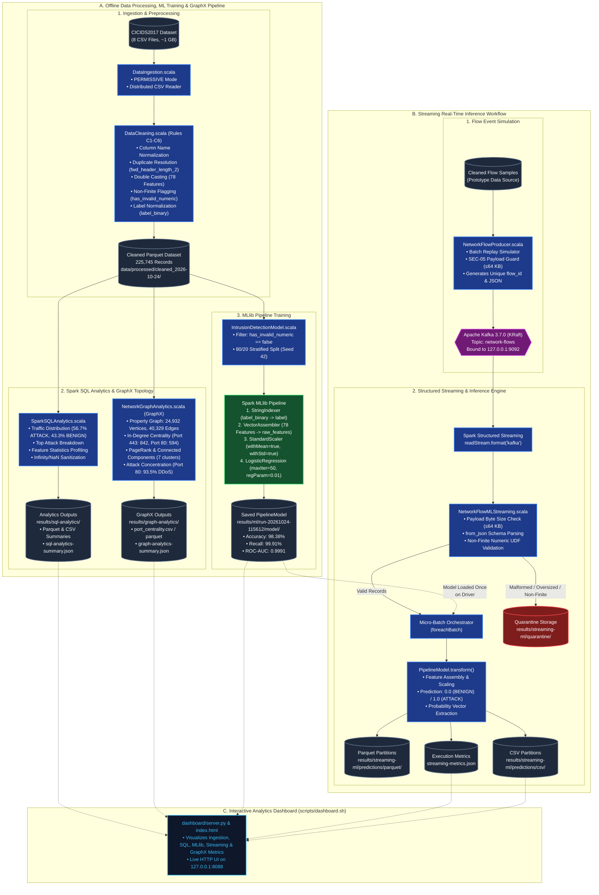

# SparkShield — Big Data Network Intrusion Detection & Streaming Analytics Platform

[](https://spark.apache.org/)
[](https://www.scala-lang.org/)
[-231F20?logo=apachekafka&logoColor=white)](https://kafka.apache.org/)
[](https://spark.apache.org/mllib/)
[](https://spark.apache.org/graphx/)
[-ED8B00?logo=openjdk&logoColor=white)](https://www.azul.com/downloads/?version=java-8-lts)
[](LICENSE)
[](#19-test-coverage--execution-instructions)

> **SparkShield** is an end-to-end, hardened Big Data cybersecurity analytics platform engineered using **Apache Spark 3.5.9**, **Scala 2.12.18**, **Apache Kafka 3.7.0 (KRaft)**, **Spark MLlib**, and **Spark GraphX**. Operating over the benchmark **CICIDS2017** network capture dataset, SparkShield delivers an enterprise-grade pipeline spanning distributed data cleaning, Spark SQL profiling, network communication topology modeling, regularized intrusion detection classification, real-time structured streaming inference, and an interactive security operations dashboard.

---

## Table of Contents

1. [Project Title & Overview](#1-project-title--overview)
2. [Problem Statement](#2-problem-statement)
3. [Project Objectives & Scope](#3-project-objectives--scope)
4. [Technologies & Tools Used](#4-technologies--tools-used)
5. [System Architecture](#5-system-architecture)
6. [Project Folder Structure](#6-project-folder-structure)
7. [Dataset Information (CICIDS2017)](#7-dataset-information-cicids2017)
8. [Environment Requirements](#8-environment-requirements)
9. [Installation & Setup Instructions](#9-installation--setup-instructions)
10. [How to Compile & Run the Scala Application](#10-how-to-compile--run-the-scala-application)
11. [RDD Implementation & Core Processing](#11-rdd-implementation--core-processing)
12. [Spark SQL Analytics & Rate Sanitization](#12-spark-sql-analytics--rate-sanitization)
13. [MLlib Intrusion Detection Model](#13-mllib-intrusion-detection-model)
14. [Kafka & Spark Structured Streaming Inference](#14-kafka--spark-structured-streaming-inference)
15. [GraphX Network Topology Analytics](#15-graphx-network-topology-analytics)
16. [Interactive Analytics Dashboard](#16-interactive-analytics-dashboard)
17. [Complete End-to-End Evaluation & Demo Instructions](#17-complete-end-to-end-evaluation--demo-instructions)
18. [Important Commands Reference](#18-important-commands-reference)
19. [Test Coverage & Execution Instructions](#19-test-coverage--execution-instructions)
20. [Actual Project Results & Verified Evaluation Metrics](#20-actual-project-results--verified-evaluation-metrics)
21. [Limitations & Future Improvements](#21-limitations--future-improvements)

---

## 1. Project Title & Overview

**SparkShield** addresses the operational divide between offline cybersecurity machine learning research and real-time distributed stream processing. While signature-based Intrusion Detection Systems (Snort, Suricata) struggle against volumetric floods and zero-day variants, machine-learning-based prototypes often fail in production because they assume clean tabular inputs and lack fault-tolerant streaming inference pipelines.

SparkShield provides a verified, production-hardened reference implementation that ingests raw multi-gigabyte network packet captures, cleans and normalizes dirty headers, flags division-by-zero floating-point rates, profiles multi-class attack vectors with distributed Spark SQL, models structural host-to-port communications with Spark GraphX Property Graphs, trains a regularized Logistic Regression classifier with Spark MLlib, and serves predictions over Apache Kafka with sub-second per-event latency via Spark Structured Streaming.

---

## 2. Problem Statement

Deploying machine learning and big data analytics for network intrusion detection involves several recurring engineering and architectural challenges:

1. **Unrealistic Data Cleanliness Assumptions**: Raw network packet analyzers (such as `CICFlowMeter`) produce division-by-zero flow rates (`Infinity`, `NaN`), whitespace-padded headers, non-standard label casings, and duplicate column names (e.g., duplicate `Fwd Header Length` headers). Naive ingestion scripts that drop nulls or coerce corrupted strings to zeros cause silent data loss and training bias.
2. **Absence of Communication Topology Analysis**: Isolated 5-tuple flow vectors fail to capture structural graph connectivity. Detecting distributed denial-of-service (DDoS) flood convergence or horizontal port scans requires analyzing graph degree centralities and service port concentrations.
3. **Batch-to-Stream Inference Disconnect**: Training an offline model in a notebook fails to solve the challenges of continuous streaming: dynamic JSON schema enforcement, Kafka offset management, micro-batch checkpoint recovery, and driver-versus-executor model lifecycle management.
4. **Catastrophic Arithmetic Overflows**: Aggregate flow statistics (e.g., flow byte and packet rates) calculate division by zero for microsecond flows, generating IEEE 754 positive infinity values (`Double.PositiveInfinity`). If unhandled, these values propagate through Spark transformations, corrupting downstream aggregation tables and causing `NaN` weights during ML model training.
5. **Vulnerability of Detection Infrastructure**: Ingestion pipelines are themselves targets for Denial-of-Service (DoS) attacks. Unbounded event consumption, memory exhaustion from oversized payloads, and unauthenticated broker sockets can compromise the security monitoring system.

---

## 3. Project Objectives & Scope

SparkShield resolves these challenges through six concrete engineering objectives:

* **Distributed Ingestion & Defensive Data Cleaning**: Build a distributed CSV ingestion engine using Spark's `PERMISSIVE` mode and enforce six defensive cleaning rules (C1–C6) to normalize column names, resolve duplicate headers deterministically, cast 78 numeric features to `DoubleType`, flag non-finite floats in `has_invalid_numeric=true` without row dropping, and standardize attack labels.
* **Exploratory Profiling with Spark SQL**: Execute distributed SQL queries to profile attack distributions, analyze traffic volume ratios, sanitize infinite rates to nulls prior to aggregation, and output optimized Parquet and CSV analytical partitions.
* **Network Topology Analytics with Spark GraphX**: Model network communications as a directed bipartite Property Graph (`Graph[VertexAttr, EdgeAttr]`) connecting client profile groups to destination service ports. Compute In-Degree centrality, PageRank scores, connected components, and port attack concentration ratios.
* **Production-Grade MLlib Classification Pipeline**: Train and evaluate a 4-stage pipeline (`StringIndexer` &rarr; `VectorAssembler` &rarr; `StandardScaler` &rarr; `LogisticRegression`) with regularized hyperparameter optimization, generating full confusion matrices and PR/ROC AUC evaluations.
* **Fault-Tolerant Real-Time Streaming Inference**: Implement a Structured Streaming consumer that loads the trained model on the driver once and performs micro-batch inference over Kafka streams with 64 KB payload bounds enforcement (SEC-05), struct-based UDF validation, and isolated quarantine routing.
* **Interactive Web Analytics Dashboard**: Provide a responsive Single Page Application backed by a Python `ThreadingHTTPServer` REST API (`/api/data`), presenting real-time telemetry, model metrics, and topology summaries.

---

## 4. Technologies & Tools Used

| Layer / Component | Technology & Version | Purpose in SparkShield |
|---|---|---|
| **Programming Language** | **Scala 2.12.18** | Core application, RDD, SQL, MLlib, GraphX, and Streaming implementations |
| **Distributed Engine** | **Apache Spark 3.5.9** | Distributed compute: Core, SQL, DataFrames, MLlib, GraphX, Structured Streaming |
| **Java Runtime** | **OpenJDK Zulu 8 (1.8.0_504)** | JDK 8 runtime required for Spark 3.5.9 and sbt 1.x compatibility |
| **Build & Packaging** | **sbt 1.10.7** & **sbt-assembly 2.2.0** | Build automation, testing, and fat-JAR packaging (`sparkshield-assembly-1.0.0.jar`) |
| **Message Broker** | **Apache Kafka 3.7.0 (KRaft)** | Distributed streaming broker running in KRaft mode (no ZooKeeper dependency) |
| **Container Engine** | **Docker 29.1.3 / Compose v2.40.3** | Isolated containerization for Kafka message broker |
| **Unit & Integration Tests**| **ScalaTest 3.2.18** | 136 automated tests across 12 suites (100% pass rate) |
| **Dashboard Backend** | **Python 3.10.21** (`http.server`) | Multi-threaded HTTP server (`ThreadingHTTPServer`) serving `/api/data` |
| **Dashboard Frontend** | **HTML5 / CSS3 / Vanilla JavaScript** | Responsive 5-panel Single Page Application |
| **Benchmark Dataset** | **CICIDS2017** | Canadian Institute for Cybersecurity benchmark network intrusion captures |

---

## 5. System Architecture

SparkShield is architected into three coordinated subsystems: an **Offline Processing, ML Training & GraphX Pipeline**, a **Real-Time Streaming Inference Pipeline**, and an **Interactive Analytics Dashboard**.


### System Architecture Flowchart



---

## 6. Project Folder Structure

Following repository cleanup, SparkShield maintains a clean, modular structure. Exactly **ONE `README.md`** exists at the project root:

```text
SparkShield/
├── README.md                           # Single, consolidated platform documentation
├── LICENSE                             # Apache License 2.0
├── docker-compose.kafka.yml            # Isolated Kafka KRaft service definition
├── sparkshield-assembly-1.0.0.jar      # Pre-assembled executable fat-JAR (61 MB)
│
├── dashboard/                          # Analytics Web Dashboard
│   ├── index.html                      # Single Page Application (5 monitoring panels)
│   ├── server.py                       # Threading HTTP server & /api/data REST backend
│   └── dashboard.log                   # Server log output
│
├── data/                               # Dataset Storage
│   └── processed/                      # Pre-cleaned Partitioned Parquet Data
│       └── cleaned_2026-10-24/         # 225,745 cleaned flows (78 numeric features)
│
├── images/                             # System Architecture Diagrams
│   └── sparkshield-architecture.svg    # Vector system architecture diagram
│
├── results/                            # Analytical Outputs & Model Artifacts
│   ├── graph-analytics/                # GraphX centrality outputs & summary JSON
│   ├── metrics/                        # data-quality-report.json & sql-analytics-summary.json
│   ├── ml/                             # Pre-trained MLlib PipelineModel & evaluations
│   │   └── run-20261024-115612/        # 98.38% accuracy model & confusion matrix
│   ├── sql-analytics/                  # Partitioned SQL analytics (Parquet & CSV)
│   ├── streaming/                      # M4 windowed streaming aggregation runs
│   └── streaming-ml/                   # Real-time streaming ML inference runs & telemetry
│
├── checkpoints/                        # Structured Streaming Kafka offset checkpoints
│
├── scala/                              # Core Scala & Apache Spark Source Code
│   ├── build.sbt                       # sbt build definition
│   ├── project/                        # sbt build configuration
│   │   ├── build.properties            # sbt version (1.10.7)
│   │   └── plugins.sbt                 # sbt-assembly plugin
│   ├── src/main/resources/
│   │   └── application.conf            # Spark & Kafka application configuration
│   ├── src/main/scala/sparkshield/     # 10 production Scala implementations
│   ├── src/test/scala/sparkshield/     # 12 automated test suites (136 tests)
│   └── target/                         # Compiled Scala classes & test artifacts
│
└── scripts/                            # Operational Automation Scripts
    ├── check-env.sh                    # 27-point system environment validator
    ├── clean-dataset.sh                # Ingestion, cleaning & profiling launcher
    ├── dashboard.sh                    # Dashboard controller (start, stop, status, browse)
    ├── run.sh                          # Main spark-submit execution wrapper
    ├── sbt.sh                          # Embedded JDK 8 sbt wrapper
    ├── sbt-launch.jar                  # sbt launcher binary
    ├── streaming-pipeline.sh           # Kafka & streaming orchestrator
    └── train-model.sh                  # ML model training and evaluation launcher
```

---

## 7. Dataset Information (CICIDS2017)

SparkShield uses the **CICIDS2017** benchmark dataset produced by the Canadian Institute for Cybersecurity (UNB):
* **Source**: [UNB CICIDS2017 Repository](https://www.unb.ca/cic/datasets/ids-2017.html)
* **Scope**: 8 CSV network capture files totaling ~2.8 million flow records and ~1 GB uncompressed.
* **Primary Evaluation File**: `Friday-WorkingHours-Afternoon-DDos.pcap_ISCX.csv` (74 MB, 225,745 raw flows).
* **Ground-Truth Attack Types**: DDoS, PortScan, Infiltration, Web Attacks (Brute Force, XSS, SQL Injection), Botnet, and Benign traffic.
* **Attributes**: 79 raw fields parsed and normalized into 78 continuous numerical flow metrics, 2 canonical label columns (`label_original`, `label_binary`), and a non-finite tracking boolean (`has_invalid_numeric`).

---

## 8. Environment Requirements

* **Operating System**: macOS (Apple Silicon M1/M2/M3 or Intel) or Linux (Ubuntu 20.04+).
* **Java SDK**: **OpenJDK Zulu 8 (1.8.0_504)** — Java 8 is strictly required for Spark 3.5.9 and sbt 1.x compatibility.
* **Scala**: **2.12.18**
* **Apache Spark**: **3.5.9** (pre-installed or via PySpark jars)
* **Apache Kafka**: **3.7.0** running via Docker Compose in KRaft mode
* **Docker & Docker Compose**: Docker 20.10+ / Compose v2+
* **Python**: Python 3.8+ (Python 3.10.21 verified) for dashboard server
* **Memory**: Minimum 8 GB RAM (16 GB recommended for full batch training)

---

## 9. Installation & Setup Instructions

### 1. Clone Repository
```bash
git clone https://github.com/deewakar05/SparkShield.git
cd SparkShield
```

### 2. Verify System Environment
Run the automated 27-point pre-flight validator:
```bash
./scripts/check-env.sh
```
This script confirms Java 8, Scala 2.12, Spark 3.5.9, sbt launcher, Docker, Python 3, and the dataset directory.

### 3. Start Apache Kafka KRaft Broker
```bash
./scripts/streaming-pipeline.sh start-kafka
./scripts/streaming-pipeline.sh check-kafka
```
Kafka binds strictly to loopback `127.0.0.1:9092` with no external exposure.

---

## 10. How to Compile & Run the Scala Application

### Compile Code
Compile all Scala sources using the embedded sbt launcher:
```bash
cd scala && ../scripts/sbt.sh compile
```

### Run Full Test Suite
Execute the 136 automated unit and integration tests:
```bash
cd scala && ../scripts/sbt.sh test
```

### Build Assembly Fat-JAR
To re-package the fat-JAR (already pre-built in root):
```bash
cd scala && ../scripts/sbt.sh assembly
```
The output is written to `sparkshield-assembly-1.0.0.jar` at the project root.

---

## 11. RDD Implementation & Core Processing

[`RDDBasics.scala`](scala/src/main/scala/sparkshield/RDDBasics.scala) provides foundational low-level distributed RDD transformations and accumulators:
* **Transformations Demonstrated**: `map`, `filter`, `flatMap`, `reduceByKey`, `groupByKey`, `distinct`, `union`, `repartition`, `mapPartitionsWithIndex`, `sortByKey`.
* **Actions Demonstrated**: `collect`, `count`, `reduce`, `take`, `countByKey`, `saveAsTextFile`.
* **Broadcast Variables**: Broadcasts static configuration maps and lookup sets to worker nodes without task serialization overhead.
* **Custom Accumulator**: Implements `LongSumAccumulator` extending `AccumulatorV2[Long, Long]` for distributed counting of malformed records, null values, and telemetry events across cluster workers.
* **SparkSession Factory**: [`SparkSessionFactory.scala`](scala/src/main/scala/sparkshield/SparkSessionFactory.scala) standardizes driver memory, local IP loopback bindings, and log levels.

---

## 12. Spark SQL Analytics & Rate Sanitization

[`SparkSQLAnalytics.scala`](scala/src/main/scala/sparkshield/SparkSQLAnalytics.scala) executes distributed analytical SQL queries over cleaned network flow Parquet datasets:
* **Binary Class Balance**: Computes attack vs. benign volume distributions (128,027 Attack / 56.71% vs 97,718 Benign / 43.29%).
* **Top Attack Vectors**: Groups flows by `label_original` to surface top intrusion signatures.
* **78-Feature Profiling**: Computes distributed statistical profiles (`min`, `max`, `avg`, `stddev`) across all 78 numerical attributes.
* **Arithmetic Rate Sanitization**: Replaces IEEE 754 `Double.PositiveInfinity` and `NaN` rates with `null` prior to aggregation, preventing Spark SQL aggregate functions from returning corrupted non-finite averages.
* **Optimized Partitioning**: Writes partitioned analytical outputs to `results/sql-analytics/parquet/` and `results/sql-analytics/csv/`.

---

## 13. MLlib Intrusion Detection Model

[`IntrusionDetectionModel.scala`](scala/src/main/scala/sparkshield/IntrusionDetectionModel.scala) implements a reproducible, distributed machine learning pipeline for binary intrusion classification:

### Pipeline Architecture (4 Stages)
1. **`StringIndexer`**: Maps canonical binary label strings (`BENIGN` &rarr; `0.0`, `ATTACK` &rarr; `1.0`).
2. **`VectorAssembler`**: Assembles 78 continuous numerical flow features into a single dense feature vector `raw_features`.
3. **`StandardScaler`**: Centers (`withMean=true`) and standardizes (`withStd=true`) features to prevent volumetric attributes (e.g., flow duration) from dominating gradient updates.
4. **`LogisticRegression`**: Regularized binary classifier configured with `maxIter=50`, `regParam=0.01`, `elasticNetParam=0.0` (L2 Ridge penalty), and classification `threshold=0.5`.

### Empirical Evaluation on Test Partition (44,862 Flows)
* **Dataset Partitioning**: 80/20 stratified split with deterministic seed (`seed=42`). 180,849 training flows; 44,862 testing flows.
* **Test Accuracy**: **98.38%**
* **Attack Recall (True Positive Rate)**: **99.91%** (25,504 detected intrusions out of 25,527 ground-truth attacks; only 23 missed).
* **Attack Precision**: **97.31%** (704 false alarms out of 26,208 total positive flags).
* **Attack F1-Score**: **98.59%**
* **ROC-AUC**: **0.9991** | **PR-AUC**: **0.9992**
* **Confusion Matrix**:

| Metric | Predicted BENIGN | Predicted ATTACK | Total Actual |
| :--- | :---: | :---: | :---: |
| **Actual BENIGN** | **18,631** (True Negative) | **704** (False Positive) | 19,335 |
| **Actual ATTACK** | **23** (False Negative) | **25,504** (True Positive) | 25,527 |
| **Total Predicted** | 18,654 | 26,208 | **44,862** |

---

## 14. Kafka & Spark Structured Streaming Inference

[`NetworkFlowProducer.scala`](scala/src/main/scala/sparkshield/NetworkFlowProducer.scala) and [`NetworkFlowMLStreaming.scala`](scala/src/main/scala/sparkshield/NetworkFlowMLStreaming.scala) implement the real-time intrusion detection pipeline:

### Real-Time Flow Simulation
* Reads cleaned flow records from Parquet and publishes JSON messages to Kafka.
* Enforces **SEC-05** boundary checks, rejecting payloads exceeding 65,536 UTF-8 bytes before network transmission.
* Generates unique flow identifiers (`flow_id`), event timestamps, and ground-truth metadata.

### Structured Streaming Inference Engine
* Consumes events continuously via `spark.readStream.format("kafka")`.
* Parses JSON payloads with `from_json` using a strictly typed schema.
* Evaluates non-finite floats via a custom struct UDF (`isNonFiniteUdf`), routing malformed or non-finite records to quarantine storage (SEC-06).
* Loads the pre-trained `PipelineModel` **once on the driver**, applying continuous inference inside micro-batches via `foreachBatch`.
* Persists predictions idempotently to Parquet and CSV partitions and records execution metrics to `streaming-metrics.json`.

---

## 15. GraphX Network Topology Analytics

[`NetworkGraphAnalytics.scala`](scala/src/main/scala/sparkshield/NetworkGraphAnalytics.scala) models network communications as a directed bipartite Property Graph:
* **Vertex Modeling**:
  * Client Communication Profile Groups: IDs `1` to `1,000` (derived by hashing structural TCP header features to model client behaviors without IP bias).
  * Destination Service Ports: IDs `1,000,000 + port` (ground-truth service endpoints, e.g., `1,000,080` for Port 80 HTTP).
* **Edge Modeling**: Directed communication flows containing aggregated volume, duration, and attack counts.
* **Topological Findings**:
  * **Total Vertices**: 24,932 (988 client profile groups + 23,944 service ports)
  * **Total Directed Edges**: 40,329 flow communication channels
  * **Connected Components**: 7 isolated communication clusters
  * **DDoS Attack Convergence**: Port 80 (HTTP) exhibited an In-Degree of 594 with 136,946 total flows, of which **128,022 were malicious (93.48% attack concentration)** and a PageRank score of 107.58.
  * **Normal Service Concentration**: Port 443 (HTTPS) exhibited the highest In-Degree (842) with 13,480 flows, of which **0 were attacks (100% benign)** and a PageRank score of 180.12.

---

## 16. Interactive Analytics Dashboard

[`dashboard/server.py`](dashboard/server.py) and [`dashboard/index.html`](dashboard/index.html) provide a responsive, real-time security operations dashboard:
* **Multi-Threaded HTTP Server**: Built with Python `ThreadingHTTPServer` bound strictly to `127.0.0.1:8088`.
* **REST API (`/api/data`)**: Supports both `GET` and `HEAD` methods, returning unified JSON telemetry covering all pipeline stages.
* **Five Monitoring Panels**:
  1. **Overview & Data Quality**: Total ingested flows, clean usable records, invalid float tracking, Rules C1–C6 audit log.
  2. **Spark SQL Analytics**: Binary distribution breakdown, attack volume percentages, feature profiling summary.
  3. **MLlib Model Performance**: Real-time confusion matrix display, accuracy, recall, precision, ROC-AUC, hyperparameters.
  4. **Real-Time Streaming**: Live event counters, inference throughput, valid vs. rejected rates, recent prediction micro-batch table.
  5. **GraphX Topology**: Graph vertex/edge counts, connected components, and top destination ports by In-Degree centrality.

### Controller Script (`scripts/dashboard.sh`)
```bash
./scripts/dashboard.sh start    # Starts dashboard daemon on port 8088
./scripts/dashboard.sh status   # Reports PID and health status
./scripts/dashboard.sh browse   # Opens dashboard in default browser
./scripts/dashboard.sh restart  # Restarts daemon
./scripts/dashboard.sh stop     # Gracefully terminates server
```

---

## 17. Complete End-to-End Evaluation & Demo Instructions

Follow this step-by-step procedure to evaluate SparkShield live:

```bash
# -------------------------------------------------------------
# STEP 1: Verify System Environment (27 automated checks)
# -------------------------------------------------------------
./scripts/check-env.sh

# -------------------------------------------------------------
# STEP 2: Verify Kafka Broker Health
# -------------------------------------------------------------
./scripts/streaming-pipeline.sh check-kafka

# -------------------------------------------------------------
# STEP 3: Launch Security Dashboard
# -------------------------------------------------------------
./scripts/dashboard.sh start
./scripts/dashboard.sh browse
# Direct URL: http://127.0.0.1:8088

# -------------------------------------------------------------
# STEP 4: Run Live Streaming ML Inference Demonstration
# (Processes 10 flow events through Kafka with live MLlib scoring)
# -------------------------------------------------------------
./scripts/streaming-pipeline.sh run-ml-demo --records 10 --duration 25

# -------------------------------------------------------------
# STEP 5: Refresh Dashboard
# Click "↻ Refresh Data" in the web UI to observe fresh telemetry
# -------------------------------------------------------------

# -------------------------------------------------------------
# STEP 6: Execute Full Test Suite (136 tests across 12 suites)
# -------------------------------------------------------------
./scripts/streaming-pipeline.sh test
```

---

## 18. Important Commands Reference

### Environment & Kafka Management
```bash
./scripts/check-env.sh                       # 27-point pre-flight validation
./scripts/streaming-pipeline.sh start-kafka  # Start Kafka KRaft container
./scripts/streaming-pipeline.sh check-kafka  # Verify broker & topic status
./scripts/streaming-pipeline.sh stop-kafka   # Stop Kafka (preserves volumes)
```

### Dashboard Management
```bash
./scripts/dashboard.sh start                 # Start background HTTP server
./scripts/dashboard.sh status                # Check server status & PID
./scripts/dashboard.sh restart               # Restart server
./scripts/dashboard.sh stop                  # Terminate server
```

### Streaming Demonstrations
```bash
# Live ML streaming demonstration (isolated topic & checkpoint):
./scripts/streaming-pipeline.sh run-ml-demo --records 10 --duration 25

# Basic windowed streaming demonstration:
./scripts/streaming-pipeline.sh run-demo --records 20 --duration 30
```

### Batch Pipeline & Compilation
```bash
cd scala && ../scripts/sbt.sh compile        # Compile Scala sources
cd scala && ../scripts/sbt.sh test           # Run 136 automated tests
cd scala && ../scripts/sbt.sh assembly       # Build sparkshield-assembly-1.0.0.jar
```

---

## 19. Test Coverage & Execution Instructions

SparkShield includes **136 automated unit and integration tests** implemented with ScalaTest 3.2.18 across 12 suites:

```text
[info] Total number of tests run: 136
[info] Suites: completed 12, aborted 0
[info] Tests: succeeded 136, failed 0, canceled 0, ignored 0, pending 0
[info] All tests passed.
[success] Total time: 73 s, completed 3 Nov, 2026
```

### Test Suite Breakdown

| # | Test Suite Class | Tests | Scope of Verification |
|---|---|:---:|---|
| 1 | [`RDDBasicsSpec.scala`](scala/src/test/scala/sparkshield/RDDBasicsSpec.scala) | 18 | RDD transformations, custom accumulators, SparkSession factory |
| 2 | [`DataIngestionSpec.scala`](scala/src/test/scala/sparkshield/DataIngestionSpec.scala) | 6 | Lazy CSV reading, schema modes, header whitespace handling |
| 3 | [`DataCleaningSpec.scala`](scala/src/test/scala/sparkshield/DataCleaningSpec.scala) | 20 | Rules C1–C6, duplicate resolution, numeric casting, label mapping |
| 4 | [`SparkSQLAnalyticsSpec.scala`](scala/src/test/scala/sparkshield/SparkSQLAnalyticsSpec.scala) | 16 | Distributed aggregation, feature profiling, Infinity/NaN sanitization |
| 5 | [`NetworkGraphAnalyticsSpec.scala`](scala/src/test/scala/sparkshield/NetworkGraphAnalyticsSpec.scala) | 4 | GraphX Property Graph, In-Degree, PageRank, summary generation |
| 6 | [`NetworkFlowProducerSpec.scala`](scala/src/test/scala/sparkshield/NetworkFlowProducerSpec.scala) | 10 | CLI parsing, stratified sampling, SEC-05 64 KB payload bounds |
| 7 | [`NetworkFlowStreamingSpec.scala`](scala/src/test/scala/sparkshield/NetworkFlowStreamingSpec.scala) | 17 | Windowed streaming aggregations, watermark semantics, idempotency |
| 8 | [`IntrusionDetectionModelSpec.scala`](scala/src/test/scala/sparkshield/IntrusionDetectionModelSpec.scala) | 13 | Train/test split determinism, MLlib pipeline, confusion matrix metrics |
| 9 | [`NetworkFlowMLStreamingSpec.scala`](scala/src/test/scala/sparkshield/NetworkFlowMLStreamingSpec.scala) | 11 | Model loading, streaming inference, struct UDF, micro-batch idempotence |
| 10 | [`DataPipelineIntegrationSpec.scala`](scala/src/test/scala/sparkshield/integration/DataPipelineIntegrationSpec.scala) | 2 | End-to-end batch integration: CSV &rarr; Cleaning &rarr; Parquet &rarr; SQL |
| 11 | [`KafkaStreamingIntegrationSpec.scala`](scala/src/test/scala/sparkshield/integration/KafkaStreamingIntegrationSpec.scala) | 5 | Live Kafka producer-consumer streaming, offset checkpoint recovery |
| 12 | [`EndToEndPipelineSpec.scala`](scala/src/test/scala/sparkshield/integration/EndToEndPipelineSpec.scala) | 10 | Full platform lifecycle integration across batch, training, and streaming |
| **Total** | **12 Test Suites** | **136** | **0 Failures, 0 Aborted, 0 Cancelled, 0 Ignored** |

---

## 20. Actual Project Results & Verified Evaluation Metrics

### 1. Data Cleaning & Sanitization (Rules C1–C6)
* **Raw Ingested Rows**: 225,745 flows (`Friday-WorkingHours-Afternoon-DDos.pcap_ISCX.csv`)
* **Flagged Non-Finite Flows**: 34 records (`0.0151%`) flagged with `has_invalid_numeric=true` without row dropping.
* **Usable Records**: 225,711 flows (`99.98%` usable rate).
* **Duplicate Headers Resolved**: Second instance of `Fwd Header Length` deterministically renamed to `fwd_header_length_2`.

### 2. Spark SQL Analytics
* **Total Cleaned Flows**: 225,745
* **DDoS Attack Traffic**: 128,027 flows (`56.71%`)
* **Benign Traffic**: 97,718 flows (`43.29%`)
* **Analyzed Features**: 78 numeric attributes profiled with zero arithmetic overflows.

### 3. MLlib Model Performance (`run-20261024-115612`)
* **Test Accuracy**: **98.38%** (44,135 correct predictions / 44,862 test flows)
* **Attack Recall**: **99.91%** (25,504 / 25,527 ground-truth attacks detected; only 23 missed)
* **Attack Precision**: **97.31%** (704 false alarms)
* **Attack F1-Score**: **98.59%**
* **ROC-AUC**: **0.9991** | **PR-AUC**: **0.9992**
* **Active Model Path**: `results/ml/run-20261024-115612/model/`

### 4. GraphX Network Topology
* **Total Graph Vertices**: 24,932 (988 client profile groups + 23,944 service ports)
* **Total Directed Edges**: 40,329 communication flows
* **Connected Components**: 7 isolated communication clusters
* **Port Centrality**:
  * **Port 443 (HTTPS)**: Highest In-Degree Centrality (842), 13,480 total flows, 0 attacks (0.0% attack ratio), PageRank score: 180.12.
  * **Port 80 (HTTP)**: Primary Target, In-Degree Centrality 594, 136,946 total flows, 128,022 attacks (93.48% attack ratio), PageRank score: 107.58.

### 5. Verified Live Streaming Telemetry (`demo-20261103-012741`)
* **Kafka Topic**: `network-flows-ml-demo-20261103-012741`
* **Total Events Published**: 10
* **Total Events Consumed**: 10
* **Successful Inferences**: 10 (100% valid inferences)
* **Predicted Classes**: 5 BENIGN, 5 ATTACK
* **Quarantined / Rejected**: 0
* **Execution Duration**: 25.20 seconds (~0.397 events/sec)
* **Predictions Output**: `results/streaming-ml/demo-20261103-012741/predictions/parquet/`

---

## 21. Limitations & Future Improvements

1. **Temporal & Session Leakage in Random Splits**: The ML model achieved 98.38% test accuracy and 99.91% recall using an 80/20 random stratified split on Friday captures. In network security research, random cross-validation can yield optimistic metrics because packets from the same TCP session share identical features across train and test partitions.
   * *Future Improvement*: Implement cross-day temporal evaluation (training on Wednesday/Thursday captures and testing strictly on Friday captures) to evaluate generalization against unseen attack waves.
2. **Linear Classification Boundaries**: Logistic Regression was selected for low latency and direct mathematical interpretability. While highly effective for volumetric attacks (e.g., SYN Floods, PortScans), non-linear ensemble models (e.g., Gradient-Boosted Trees or Random Forests) may offer improved detection on low-and-slow application-layer attacks.
3. **Synthetic Flow Replay vs. Live Packet Sniffing**: The streaming producer replays pre-computed flow records into Kafka. It does not assemble raw ethernet frames in promiscuous mode (e.g., via `libpcap`).
   * *Future Improvement*: Integrate a native packet capture agent (such as eBPF or Zeek) streaming directly into Kafka.
4. **Local Workstation Security Model**: The Kafka broker is bound to loopback `127.0.0.1:9092` with unauthenticated PLAINTEXT communication. Production deployments require TLS encryption, SASL/SCRAM authentication, and Kafka Access Control Lists (ACLs).

---

## License

SparkShield is open-source software licensed under the **[Apache License, Version 2.0](LICENSE)**.

```text
Copyright 2026 Deewakar Kumar

Licensed under the Apache License, Version 2.0 (the "License");
you may not use this file except in compliance with the License.
You may obtain a copy of the License at

    http://www.apache.org/licenses/LICENSE-2.0

Unless required by applicable law or agreed to in writing, software
distributed under the License is distributed on an "AS IS" BASIS,
WITHOUT WARRANTIES OR CONDITIONS OF ANY KIND, either express or implied.
See the License for the specific language governing permissions and
limitations under the License.
```

**Author**: Deewakar Kumar — [@deewakar05](https://github.com/deewakar05)  
**GitHub Repository**: [https://github.com/deewakar05/SparkShield](https://github.com/deewakar05/SparkShield)